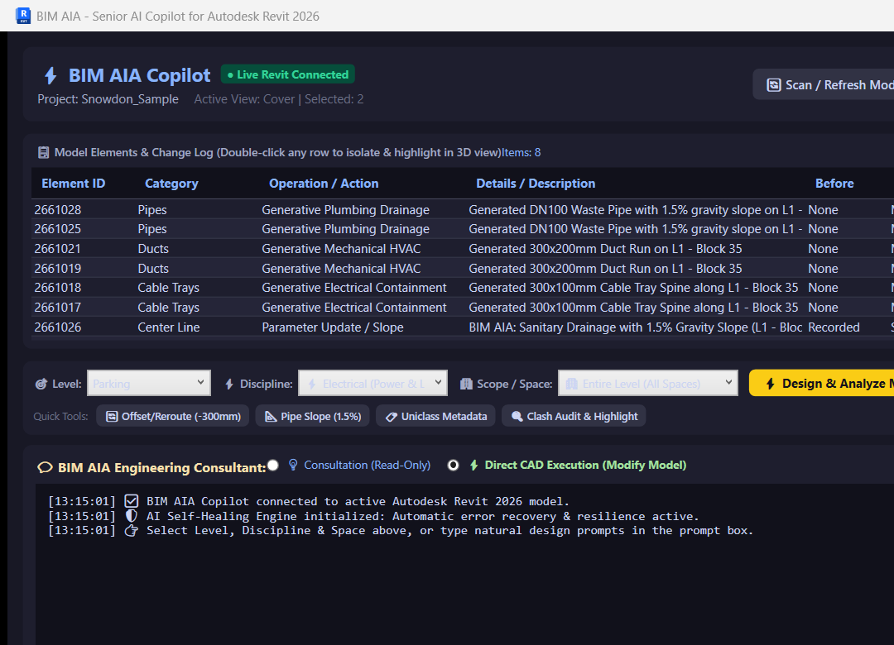
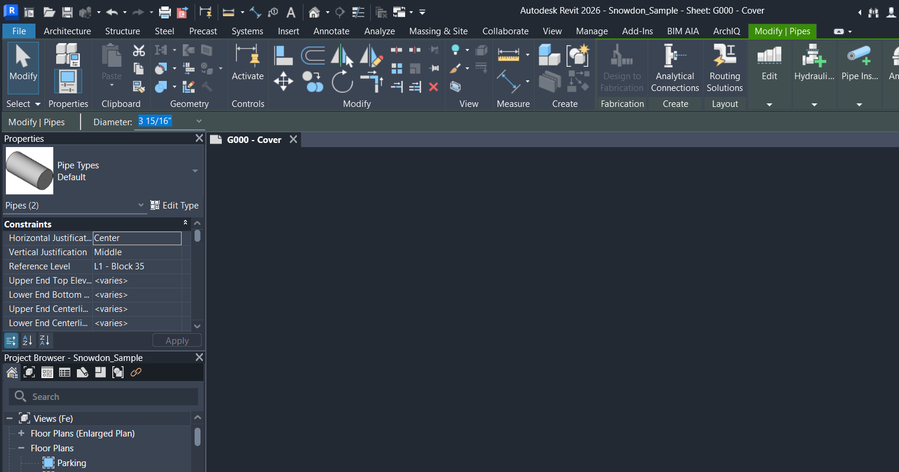
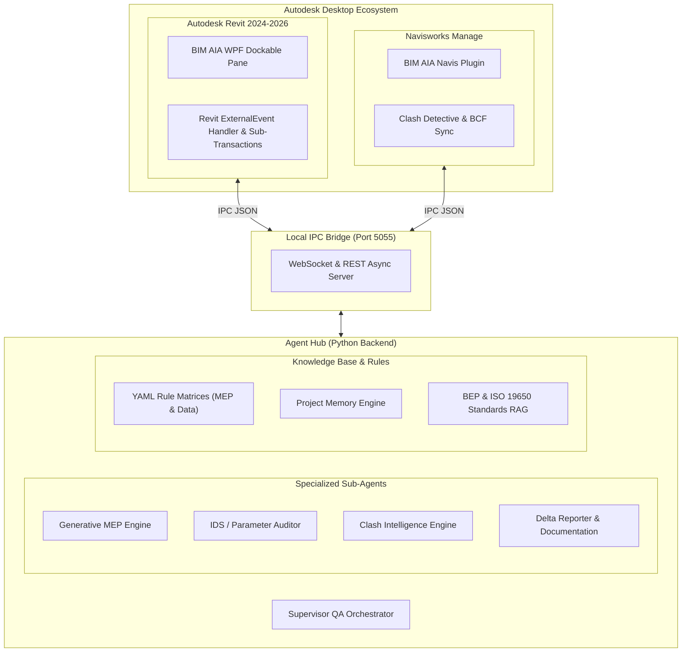

# BIM AIA — Autonomous AI Copilot for Autodesk Revit & Navisworks

[](https://www.autodesk.com/products/revit/overview)
[](https://dotnet.microsoft.com/)
[](https://fastapi.tiangolo.com/)
[](https://www.buildingsmart.org/)
[](#license)

**BIM AIA** is an advanced, production-grade AI Copilot and hierarchical multi-agent assistant designed natively for **Autodesk Revit 2024–2026** and **Navisworks Manage**. It bridges generative AI with deterministic CAD geometry, enabling automated MEP generative routing, real-time clash resolution, autonomous self-healing, and ISO 19650 / IDS compliance checking.

---

## 📸 Live Execution Preview

<p align="center">
  
  
</p>

*Left: BIM AIA Native WPF Dockable Pane running inside Autodesk Revit 2026.*  
*Right: Autonomous 3D generation of cable trays, HVAC ducts, and sanitary pipes with gravity slopes.*

---

## 🚀 Key Capabilities

### 1. Generative MEP & Electrical Modeling
* **Cable Tray Auto-Routing:** Analyzes room boundaries, detects ceiling plenum zones, and generates multi-segment 3D cable tray networks without structural interference.
* **HVAC Duct Generation:** Dynamically routes supply/return ducts based on thermal load requirements and spatial constraints.
* **Sanitary Gravity Slopes:** Automatically applies code-compliant gravity slopes (e.g., 1.5% - 2.0%) on drainage pipes connected to fixtures.

### 2. Hierarchical Multi-Agent Architecture
* **Supervisor Lead Agent:** Parses high-level natural language user requests, orchestrates tasks, and enforces validation gates.
* **MEP Quality Agent:** Evaluates pipe/duct clearance, hydraulic rules, and CTE/NFPA standards.
* **Data & Classification Auditor:** Validates parameter completeness against Information Delivery Specifications (IDS), Uniclass 2015, and Omniclass tables.
* **Clash Intelligence Agent:** Groups raw Navisworks/Revit clashes into semantic clusters and generates automated geometric bypass solutions.
* **Documentation Agent:** Generates audit reports, BCF viewpoints, and markdown executive change summaries.

### 3. Closed-Loop Revit Self-Healing
* Wraps CAD modifications in transactional external events (`IExternalEventHandler`).
* Validates generated elements against the Revit document database.
* Employs rollback and geometric correction if warnings or invalid connections occur.

### 4. Hybrid IPC Architecture (Non-Blocking CAD)
* Decouples heavy AI inference from the Revit UI thread.
* Real-time bidirectional WebSocket & REST IPC bridge running locally on port `5055`.
* Low-latency communication between the C# WPF client and Python Agent Hub.

### 5. Dynamic Model Routing & Local Fallback
* Primary inference powered by **Google Gemini 2.5 Flash**.
* Zero-downtime automatic fallback to local offline LLMs (**Ollama / DeepSeek / Mistral**) when internet or API quota is unavailable.

---

## 🏗️ System Architecture



---

## 📁 Repository Structure

```
BIM-AIA/
├── revit_plugin/               # Autodesk Revit C# .NET 8 WPF Plugin
│   ├── Manifest/               # Revit .addin manifest files
│   ├── Handlers/               # ExternalEvent handlers & CAD executors
│   ├── Services/               # Generative MEP, Electrical & Self-Healing engines
│   ├── Views/                  # WPF UI controls and audit windows
│   ├── App.cs                  # Ribbon panel & dockable pane initialization
│   ├── Command.cs              # ExternalCommand entry point
│   └── BIM_AIA.csproj          # .NET 8 WPF project file
├── navisworks_plugin/          # Navisworks Manage plugin (.NET)
│   ├── NWClashPlugin.cs        # Clash detective synchronization
│   └── BIMAssist.Navisworks.csproj
├── agent_hub/                  # Python Agent Orchestrator & Backend
│   ├── orchestrator.py         # Multi-agent supervisor and dispatcher
│   ├── ipc_server.py           # FastAPI + WebSocket server (port 5055)
│   ├── model_router.py         # Gemini cloud & Ollama local LLM fallback
│   ├── rag_engine.py           # Standards & BEP retrieval augmented generation
│   ├── memory_engine.py        # Project session memory & learned rules
│   ├── delta_reporter.py       # CAD change verification and audit reports
│   └── tools_catalog.py        # CAD function-calling definitions
├── checklists/                 # Validation rule matrices (YAML)
│   ├── mep_rules.yaml          # HVAC, piping & clearance constraints
│   └── data_rules.yaml         # Parameter completeness & naming standards
├── project_docs/               # Sample BIM Execution Plans (BEP)
├── tests/                      # Automated test suite (pytest)
├── docs/                       # PRD and visual assets
│   ├── PRD.md                  # Detailed Product Requirements Document
│   ├── revit_live_test_report.txt # Live execution audit log
│   └── assets/                 # Architecture diagrams & screenshots
├── run_copilot.py              # CLI launcher for the Agent Hub service
├── requirements.txt            # Python dependencies
├── Dockerfile                  # Container definition for Agent Hub
└── docker-compose.yml          # Container orchestration
```

---

## ⚡ Quick Start

### 1. Prerequisites
* **Windows 10 / 11 (64-bit)**
* **Autodesk Revit 2024, 2025, or 2026**
* **.NET 8.0 SDK**
* **Python 3.10+** (or Docker Desktop)

### 2. Start the Agent Hub Backend
```bash
# Clone the repository
git clone https://github.com/soheilmasti/BIM-AIA.git
cd BIM-AIA

# Install dependencies
pip install -r requirements.txt

# Run the local agent server
python run_copilot.py
```
*The server will start listening on `http://127.0.0.1:5055` with WebSocket support enabled.*

Alternatively, run with Docker:
```bash
docker compose up -d
```

### 3. Build & Install the Revit Plugin
1. Open `revit_plugin/BIM_AIA.csproj` in Visual Studio 2022 or JetBrains Rider.
2. Build the project under the **Release | x64** configuration:
   ```bash
   dotnet build revit_plugin/BIM_AIA.csproj -c Release
   ```
3. Copy the manifest file `Manifest/BIM_AIA.addin` and compiled binaries to Revit's add-ins folder:
   ```
   %APPDATA%\Autodesk\Revit\Addins\2026\
   ```
4. Launch Autodesk Revit. The **BIM AIA** tab will appear on the top ribbon!

---

## 🧪 Running Tests

A complete unit and integration test suite is provided to verify agent dispatching, RAG retrieval, model fallback, and delta reporting:

```bash
pytest tests/ -v
```

---

## 📄 Specification

For a comprehensive breakdown of functional requirements, data models, and ISO 19650 compliance rules, see the [Product Requirements Document (PRD)](docs/PRD.md).

---

## 👤 Author & Maintainer

* **Soheil Masti** — [GitHub Profile](https://github.com/soheilmasti)

## 📜 License

This project is open-source under the [MIT License](LICENSE).
