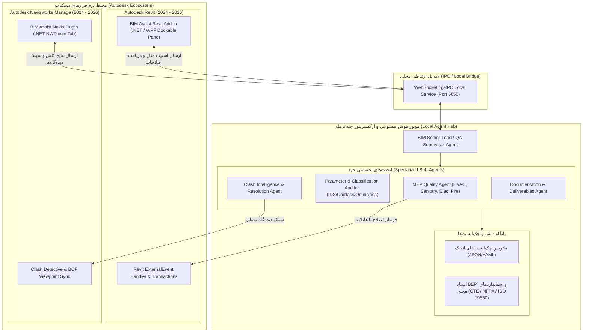
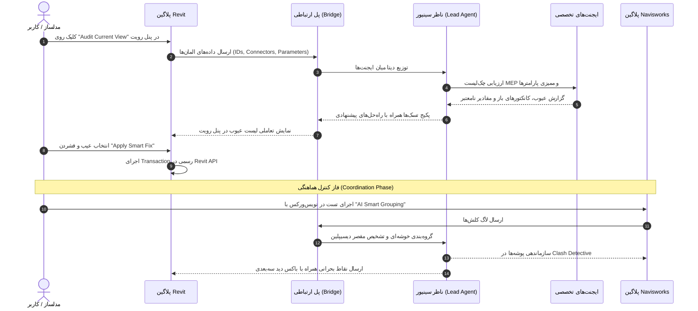

# PRD: دستیار هوشمند و سیستم چندعامله BIM AIA (Revit 2026 AI Copilot)

**نام تجاری و رسمی:** BIM AIA  
**نسخه:** 2.0.0  
**وضعیت:** مصوب برای پیاده‌سازی (Ready for Implementation)  
**محیط اجرا:** پلاگین بومی Autodesk Revit 2026 (WebView2 & .NET 8) و Navisworks Manage  
**معماری هسته:** سیستم هوشمند چندعامله سلسله‌مراتبی (Hierarchical Multi-Agent) + موتور اعتبارسنجی قوانین اتمیک (Rule & IDS Engine)

---

## ۱. چشم‌انداز محصول و بیان مسئله (Vision & Problem Statement)

### ۱.۱ مسئله (The Problem)
* **خطاهای انسانی و جزییات جاافتاده:** در پروژه‌های پیچیده BIM، صدها قانون فنی (شیب لوله‌ها، فواصل دسترسی، اتصالات، کدهای طبقه‌بندی و پارامترها) وجود دارد که کنترل دستی آن‌ها توسط مدلساز یا ناظر باعث جا افتادن خطاهای بحرانی می‌شود.
* **گسست بین مدلسازی و هماهنگی (Revit vs. Navisworks Disconnect):** بررسی کلش‌ها در نویس‌ورکس و انتقال آن به رویت فرآیندی دستی، خسته‌کننده و مستعد خطاست. هزاران کلش خام بدون دسته‌بندی هوشمند تولید می‌شوند.
* **فقدان نظارت آنی در حین کار:** معمولاً کنترل کیفیت (QA/QC) در انتهای مراحل ددلاین انجام می‌شود، در حالی که اصلاح خطا در لحظه مدلسازی ده‌ها برابر ارزان‌تر از اصلاح آن قبل از تحویل است.

### ۱.۲ ارزش پیشنهادی (Value Proposition)
**BIM Assist** یک پلتفرم هوشمند درون‌برنامه‌ای (In-App Plugin) است که مستقیماً در پنل‌های شناور (Dockable Panes) نرم‌افزارهای **Revit** و **Navisworks** می‌نشیند. این سیستم همانند یک تیم کامل شامل **طراح سینیور / مدیر بیم (Supervisor)** و **چندین ایجنت تخصصی دیسیپلین‌ها** عمل می‌کند:
1. مدل را بر اساس چک‌لیست‌های اتمیک و استانداردهای پروژه (BEP/LOD) به صورت زنده ممیزی می‌کند.
2. هیچ جزییاتی را از قلم نمی‌اندازد (Zero Missed Detail).
3. تداخلات نویس‌ورکس را هوشمندانه دسته‌بندی و مستقیماً به المنت‌های رویت متصل می‌کند.
4. پیشنهادات اصلاحی یک‌کلیکی (One-Click Fixes) را از طریق تراکنش‌های API رویت ارائه می‌دهد.

---

## ۲. معماری کلان سیستم (System Architecture)

سیستم به صورت **ترکیبی و توزیع‌شده (Hybrid Plugin-Brain Architecture)** طراحی شده است تا ضمن حفظ سرعت و عدم فریز شدن محیط‌های CAD، از قدرت پردازش هوش مصنوعی بهره‌مند شود:



---

## ۳. نقش و وظایف ایجنت‌ها (Multi-Agent Personas & RACI Matrix)

| نام ایجنت | جایگاه سازمانی معادل | ورودی‌ها (Inputs) | خروجی‌ها و اقدامات (Outputs) | ابزارها و API درگیر |
| :--- | :--- | :--- | :--- | :--- |
| **BIM Lead Supervisor** | مدیر ارشد مدل‌سازی و ناظر کیفی | اهداف پروژه، BEP، وضعیت کلی مدل | تخصیص تسک به ایجنت‌ها، محاسبه BIM Health Score، تایید خروجی شیت‌ها و مدل نهایی | لاگ کلان، تابلوی اعلان در پلاگین |
| **MEP Specialist Agent** | مهندس سینیور تاسیسات مکانیک و برق | عناصر سیستم‌ها (`MEPSystem`, کانکتورها، لوله‌ها، داکت‌ها) | چک‌لیست شیب، جهت جریان، پایداری مدار، فواصل عایق‌کاری، هشدار کانکتورهای باز | Revit API (`ConnectorManager`, `MEPCalculation`) |
| **Data & Parameter Agent** | ممیز داده و اطلاعات مدل (Information Manager) | ویژگی‌ها و پارامترهای فمیلی‌ها و تیپ‌ها | انطباق با جدول پارامترهای اجباری BEP، تزریق کدهای Uniclass/Omniclass/COBie | Revit API (`ParameterSet`, `SharedParameters`) |
| **Coordination & Clash Agent** | هماهنگ‌کننده بیم (BIM Coordinator) | داده‌های برخورد نویس‌ورکس + ژئومتری رویت | گروه‌بندی خوشه‌ای کلش‌ها (Clash Clustering)، تعیین اولویت، پیشنهاد ایجاد اسلیو خودکار | Navisworks API (`ClashTest`), BCF 3.0 |
| **Documentation & BOQ Agent** | سرپرست داکیومنتیشن و متره | ویوها، شیت‌ها، تگ‌ها و فیلترهای گرافیکی | ممیزی تگ‌گذاری کامل، فرمت جداول مقادیر (Schedules)، مقیاس دیدها و نام‌گذاری استاندارد | Revit API (`View`, `ScheduleDefinition`, `ViewSheet`) |

---

## ۴. موتور چک‌لیست‌های اتمیک (Granular 3-Tier Checklist Engine)

برای این‌که **هیچ جزییاتی از قلم نیفتد**، چک‌لیست‌ها با فرمت ساختاریافته در سه لایه تعریف می‌شوند:

### لایه ۱: فاز و استانداردهای حاکم (Phase & Governance)
* سطح توسعه هندسی و اطلاعاتی (LOD 200, 300, 350, 400).
* آیین‌نامه مبنا (مثل مقررات ملی، استانداردهای اسپانیا CTE برای DB-HS و DB-SI، یا استانداردهای بین‌المللی ASHRAE و NFPA).

### لایه ۲: سیستم و رده المان (System & Category)
* تفکیک سیستم‌ها (مثلاً: `Sanitary Drainage`, `Chilled Water Supply`, `Cable Tray Power`, `Fire Sprinklers`).

### لایه ۳: قوانین میکرو و شرایط ماشینی (Atomic Validation Rules)
هر آیتم چک‌لیست شامل یک شرط ارزیابی قطعی است:
```yaml
rule_id: "MEP-PLUMB-042"
category: "Pipes"
system_classification: "Sanitary"
description: "شیب حداقل لوله‌های افقی فاضلاب بر اساس قطر نامی (DN)"
validation_logic:
  - condition: "Diameter <= 110mm"
    required_slope_min: "0.015" # 1.5%
  - condition: "Diameter > 110mm"
    required_slope_min: "0.010" # 1.0%
severity: "Critical"
action_on_fail:
  type: "HighlightAndSuggest"
  suggested_transaction: "AdjustSlopeAndRiserHeight"
  bcf_flag: true
```

---

## ۵. نیازمندی‌های کارکردی پلاگین‌ها (Functional Requirements)

### ۵.۱ پلاگین Autodesk Revit (BIM Assist Dockable Panel)
* **FR-REV-01 (رابط کاربری شناور و بومی):** تعبیه یک پنل Dockable در محیط کاری رویت با قابلیت پین شدن در کنار Project Browser و Properties.
* **FR-REV-02 (اسکن لحظه‌ای و برخط دید جاری):** قابلیت بررسی مدل بر اساس «المان‌های انتخابی (Selection)»، «دید فعال جاری (Active View)» یا «کل مدل (Entire Project)».
* **FR-REV-03 (هدایت و هایلایت در محیط سه‌بعدی):** کلیک روی هر خطای چک‌لیست، دید سه‌بعدی رویت را بلافاصله بر روی المان خاطی متمرکز، ایزوله (Isolate) و هایلایت کند.
* **FR-REV-04 (اصلاحات تک‌کلیکی - Smart Auto-Fix):** اجرای اصلاحات امن (مانند تکمیل پارامترهای خالی، اتصال مجدد کانکتور، درج تگ‌های جاافتاده و درج بازشوی اسلیو) از طریق پترن استاندارد `ExternalEvent` در قالب تراکنش‌های معتبر (`Transaction.Commit()`).
* **FR-REV-05 (ارزیابی پیوستگی سیستم‌های MEP):** تشخیص مسیرهای قطع‌شده (Open Disconnected Connectors) و لوپ‌های نادرست در سیستم‌های تأسیساتی.
* **FR-REV-06 (جعبه فرمان متنی تعاملی - Natural Language Prompt Bar):** تعبیه باکس چت/فرمان در پایین پنل که کاربر می‌تواند هر دستوری را به زبان طبیعی (فارسی، انگلیسی یا اسپانیایی) تایپ کند (مثال: «داکت هوای رفت طبقه ۲ را ۵ سانتیمتر از زیر کابل‌تری‌ها پایین‌تر ببر» یا «شیب کل لوله‌های فاضلاب زون شرقی را ۲ درصد کن»). این ماژول پرامپت را به زنجیره‌ای از تراکنش‌های ایمن رویت تبدیل و پس از پیش‌نمایش، با تایید یا به صورت خودکار اجرا می‌کند.

### ۵.۲ پلاگین Autodesk Navisworks (BIM Assist Clash Orchestrator)
* **FR-NAV-01 (دسته‌بندی هوشمند تداخلات):** تبدیل هزاران کلش خام به گروه‌های منطقی بر اساس:
  * موقعیت فضایی (Zone / Level / Grid).
  * رده و سیستم (مثلاً: برخورد لوله آب باران با تیرهای سازه‌ای در طبقه دوم).
* **FR-NAV-02 (ارتباط دوطرفه با رویت - Bidirectional Viewpoint Sync):** با انتخاب هر کلش در نویس‌ورکس، المان‌های متناظر در رویت فوراً انتخاب و دوربین سه‌بعدی با همان زاویه همگام‌سازی شود.
* **FR-NAV-03 (تولید خروجی استاندارد BCF 2.1/3.0):** ذخیره موضوعات هماهنگی همراه با عکس، کامنت، وضعیت و شناسه یکتای المان (`IfcGuid` / `UniqueId`).
* **FR-NAV-04 (فرمان‌های متنی در نویس‌ورکس):** قابلیت دریافت پرامپت متنی (مثلاً: «تمام کلش‌های بین داکت و لوله گاز را با اولویت بالا در پوشه Critical_HVAC_Gas گروه‌بندی کن و به مهندس مکانیک تخصیص بده»).

### ۵.۳ موتور استنتاج و هماهنگی ایجنت‌ها بر پایه گوگل جمنای (Gemini-Powered Agent Brain)
* **استراتژی پایه هوش مصنوعی (Code-First & Grounded LLM):**
  * کارهای محاسباتی قطعی (بررسی شیب، هندسه، تقاطع‌ها، حضور پارامترها و باز بودن کانکتورها) تماماً به صورت کدنویسی دقیق و قطعی (Deterministic Code در سی‌شارپ/پایتون) بدون کوچک‌ترین خطا انجام می‌شوند.
  * **نقش جمنای:** تفسیر اسناد متنی و آیین‌نامه‌ها، تطبیق معنایی (Semantic Mapping)، حل تعارضات بین ایجنت‌ها، استنتاج علل ریشه‌ای کلش‌ها، و تولید گزارش‌ها و کامنت‌های مهندسی BCF.
  * با این معماری، هیچ نیازی به مدل‌های گران‌قیمت دیگر نخواهد بود و جمنای با بالاترین راندمان و کمترین هزینه پاسخگوی کامل سیستم است.
* **مدل‌های انتخابی و سیستم سوییچ خودکار (Automated Model Fallback Router):**
  * استفاده از کلاس اختصاصی `GeminiModelRouter` در هسته ارکستریتور.
  * **زنجیره اولویت مدل‌ها:**
    1. `gemini-3.6-flash` / `gemini-2.5-flash` (سرعت زیر ثانیه و اولویت اصلی)
    2. `gemini-2.0-flash` (پشتیبان اول)
    3. `gemini-1.5-flash` (پشتیبان دوم با پایداری و سقف ریکوئست بالا)
    4. `gemini-1.5-pro` (پشتیبان تحلیلی)
  * **مکانیزم قطع مدار و سهمیه (Circuit Breaker & Cooldown):** به محض دریافت خطای محدودیت سهمیه (HTTP 429 یا `ResourceExhausted`)، مدل بلافاصله و بدون وقفه به مدت ۱۲۰ ثانیه در حالت Cooldown قرار می‌گیرد و سیستم فوراً به مدل در دسترس بعدی سوییچ می‌کند تا هیچ تاخیری برای کاربر یا فریز شدن در CAD رخ ندهد.
  * **موتور قطعی پشتیبان (Offline/Zero-API Fallback):** در صورتی که تمام سهمیه‌ها یا اینترنت موقتاً قطع شود، سیستم به صورت کاملاً امن به موتور قطعی محلی (Deterministic Rule Engine) سوییچ می‌کند و عملیات بدون کرش ادامه می‌یابد.
* **تضمین ساختاریافتگی بدون توهم (Structured Outputs & Function Calling):**
  * تمامی خروجی‌های ایجنت‌ها با `response_mime_type="application/json"` و اسکیمای سخت‌گیرانه (Pydantic / JSON Schema) دریافت می‌شوند تا از هرگونه خروجی نامعتبر یا توهم جلوگیری شود.
  * تجهیز ایجنت سینیور به ابزارهای فراخوانی تابع (Function Calling) برای درخواست داده از رویت یا صدور دستور اصلاح.
* **FR-AI-01 (مسیریابی تصمیمات توسط ایجنت سینیور):** ایجنت ناظر، پیش از ارسال گزارش به کاربر، خروجی سایر ایجنت‌ها را تطبیق داده و مانع از ارائه پیشنهادات متناقض می‌شود (مثلاً جابه‌جایی لوله‌ای که باعث کلش با کابل‌تری جدید شود).
* **FR-AI-02 (تولید چک‌لیست سفارشی از روی سند BEP):** کاربر می‌تواند فایل PDF/Word نقشه اجرایی بیم (BEP) پروژه را بارگذاری کند؛ ایجنت سینیور به طور خودکار ماتریس الزامات پروژه را استخراج کرده و به چک‌لیست‌های سیستم تبدیل می‌کند.
* **FR-AI-03 (موتور ترجمه پرامپت به تراکنش - Prompt-to-Transaction Engine):** تبدیل پرامپت آزاد کاربر به فراخوانی‌های ساختاریافته (Tool Calls) نظیر:
  * `tool_reroute_duct(duct_id, clearance_mm, direction)`
  * `tool_set_system_slope(system_name, slope_percent)`
  * `tool_place_sleeves_at_clashes(clash_group_id, sleeve_type, clearance_mm)`
  * `tool_group_navisworks_clashes(filter_query, folder_name)`

### ۵.۴ معماری تعاملی دوحالته (Dual-Mode Interaction: Consult vs. Execute)
سیستم دارای دو حالت کاری کاملاً تفکیک‌شده در رابط کاربری است تا امنیت مدل و آسودگی خاطر مهندس تضمین شود:

* **حالت اول: بخش مشورت و استعلام فنی (Consultation & Advisory Mode - 💡):**
  * **عملکرد:** کاملاً امن و فقط-خواندنی (Read-Only)؛ مدل رویت تغییر نمی‌کند.
  * **موارد کاربرد:** 
    * پرسش در خصوص الزامات آیین‌نامه‌ها (مانند بندهای CTE اسپانیا، NFPA یا مقررات ملی).
    * تحلیل استراتژی‌های طراحی (مثال: «به نظرت برای تهویه این فضا، داکت‌اسپلیت مناسب‌تر است یا VRF با توجه به ارتفاع سقف؟»).
    * استعلام چرایی خطاها (مثال: «چرا شیب این لوله را ناکافی تشخیص دادی؟ مبنای محاسباتت چیست؟»).
  * **خروجی:** متن تحلیلی ساختاریافته، استناد به بندهای آیین‌نامه، فرمول‌های سایزینگ و مقایسه گزینه‌ها.

* **حالت دوم: بخش اجرای دستور و طراحی در مدل (Action & Execution Mode - ⚡):**
  * **عملکرد:** حالت اجرایی و متصل به موتور تراکنش‌های رویت و نویس‌ورکس.
  * **موارد کاربرد:**
    * صدور فرامین تغییر هندسی (تغییر تراز، جابه‌جایی داکت، ایجاد انحراف و بای‌پس).
    * ایجاد خودکار المان‌ها (درج اسلیوها، افزودن فیتینگ‌ها و دریچه‌ها).
* **پل انتقال مستقیم از مشورت به اجرا (Consult-to-Execute Action Bridge - نقطه عطف سیستم):**
  * کاربر ابتدا در حالت مشورت (💡) موضوعی را مطرح می‌کند (مثلاً: «اگر بخواهیم برای داکت زون غربی بای‌پس بزنیم، بهترین مسیر کجاست و چه ضوابطی دارد؟»).
  * ایجنت پاسخ تحلیلی را همراه با گزینه‌های بهینه ارائه می‌دهد.
  * در انتهای همان کارت مشورت، بلافاصله دکمه **`[ ⚡ تبدیل مشورت به اجرا در مدل (Execute this Decision) ]`** ظاهر می‌شود؛ با کلیک روی آن، سیستم بدون نیاز به تایپ مجدد، استراتژی مورد توافق را به صورت پیش‌نمایش گرافیکی بر روی مدل نشان داده و با یک کلیک اجرا می‌کند.

### ۵.۵ پایگاه دانش RAG اسناد پروژه (Project Documents RAG Hub)
* **ورودی‌های چندگانه اسناد:** قابلیت بارگذاری اسناد پروژه در پنل پلاگین در فرمت‌های مختلف:
  * اسناد متنی/PDF: دفترچه نقشه اجرایی بیم (BEP)، نیازمندی‌های اطلاعاتی کارفرما (EIR)، مشخصات فنی عمومی و خصوصی (Technical Specs)، صورتجلسات هماهنگی کارگاهی.
  * جداول داده‌ای/Excel: ماتریس تخصیص مسئولیت‌ها، جداول استانداردهای فمیلی و پارامترها (COBie / Uniclass).
* **موتور جستجوی هیبریدی (Hybrid Semantic & Keyword RAG):** اتصال به پایگاه داده وکتوری محلی جهت بازیابی دقیق بندهای قراردادی و فنی در لحظه پاسخ‌دهی ایجنت‌ها.
* **استناد معتبر (Grounded Citations):** در تمام پیشنهادات و پاسخ‌های مشورتی، شماره صفحه و نام سند مرجع دقیقاً درج می‌شود (مثال: *«طبق بند ۴.۲ سند BEP_Hospital_v2.pdf»*).

### ۵.۶ حافظه مداوم و یادگیری از تصحیحات کاربر (Continuous Learning & Memory Engine)
* **ثبت ترجیحات و استثنائات پروژه (Project Memory):**
  * چنانچه کاربر اصلاحیه‌ای را ویرایش کند یا به صورت کلامی دستوری خلاف پیش‌فرض به سیستم بدهد (مثال: *«در این پروژه برای بازشوهای تیر همیشه ۱۰ سانتیمتر تلرانس بده، نه ۵ سانتیمتر»* یا *«لوله‌های آب مصرفی از برند X با رنگ سبز مدلسازی شوند»*)، سیستم این نکته را در فایل `project_memory.json` ذخیره می‌کند.
* **حلقه بازخورد فعال (Human-in-the-Loop Feedback):**
  * پس از رد یا ویرایش هر پیشنهاد خودکار توسط مدلساز، سیستم علت آن را می‌آموزد و در تکرارهای بعدی همان بخش، مدل رفتار اصلاح‌شده کاربر را تکرار می‌کند.
* **عدم تکرار اشتباه (Zero Repeated Mistake):** تضمین می‌شود که یک تذکر اصلاحی از سوی کاربر، برای همیشه در حافظه مدل برای همان پروژه ثبت و اعمال گردد.

### ۵.۷ شتاب‌دهنده‌های جهشی بهره‌وری (High-Impact Productivity Boosters)
* **۱. گیت کنترل کیفی قبل از سینک (Pre-Sync Quality Gate):**
  * هنگام فشردن دکمه `Synchronize with Central` در رویت، سیستم یک ممیزی ۳ ثانیه‌ای اجرا کرده و در صورت وجود خطاهای فاحش (مانند کانکتور باز اصلی، فمیلی‌های فاقد شناسه، یا تداخلات شدید جدید) به مدلساز هشدار داده و گزینه اصلاح یک‌کلیکی ارائه می‌دهد.
* **۲. تگ‌گذاری و شیت‌بندی هوشمند خودکار (Smart Auto-Tagging & Sheet Automator):**
  * ترسیم تگ‌های شیب، تگ قطر لوله، و کد سیستم‌ها به صورت کاملاً خودکار و با الگوریتم ممانعت از هم‌پوشانی (Collision-free Smart Placement) که بیش از ۴۰٪ زمان نقشه‌کشی را کاهش می‌دهد.
* **۳. پایپلاین خودکار هماهنگی بازشوها (Automated Provision for Void - Builder's Work):**
  * شناسایی کلیه نقاط عبور لوله‌ها و کانال‌ها از دیوارها و تیرها، استخراج خودکار جدول اسلیوها (Sleeve Schedule) و اکسپورت با یک کلیک به فایل هماهنگی سازه.
* **۴. شمارنده زنده متره و مقادیر (Live Takeoff & Material Dashboard):**
  * محاسبه لحظه‌ای متراژ لوله‌ها، مساحت ورق کانال‌ها و تعداد فیتینگ‌ها در حین مدلسازی جهت جلوگیری از انحراف بودجه و تامین احجام مورد نیاز کارگاه.

### ۵.۸ موتور گزارش‌دهی تفاضلی و پیشرفت دوره‌ای (Comparative Delta Reporting Engine)
* **ثبت اسنپ‌شات‌های تاریخی پروژه (Milestone & Periodic Snapshots):**
  * ذخیره وضعیت کمّی و کیفی مدل در فواصل هفتگی یا در مقاطع تحویل مهم (Milestones).
* **تولید گزارش مقایسه‌ای تک‌کلیکی (One-Click Delta Progress Report):**
  * با فشردن دکمه «Generate Progress Report»، سیستم وضعیت جاری را نسبت به اسنپ‌شات قبلی مقایسه کرده و در قالب یک سند شکیل (PDF / Markdown / HTML) تحویل می‌دهد:
    1. **ترند شاخص سلامت (Health Score Trend):** ارتقای نمره کیفیت مدل (مثلاً: از ۸۱٪ به ۹۴٪ در هفته جاری).
    2. **تفاضل کلش‌های نویس‌ورکس (Clash Burndown Delta):** تعداد کلش‌های رفع‌شده (Resolved)، کلش‌های جدید ناشی از طراحی‌های تازه (New Clashes)، و موارد معلق (Active).
    3. **تکمیل داده‌ها و پارامترها:** درصد پیشرفت پر شدن پارامترهای الزامی BEP و کدهای Uniclass نسبت به هفته قبل.
    4. **افزایش احجام مدل (Modeled Quantities Delta):** میزان متراژ لوله‌ها و مساحت داکت‌های اضافه شده طی بازه.
    5. **خلاصه تصمیمات فنی کلیدی:** لیست تصمیمات و مشورت‌های مهم انجام‌شده در طول هفته بر مبنای لاگ ایجنت سینیور.
    6. **نقاط انسداد و ریسک‌های هفته بعد (Next Week Blockers & Critical Clashes).**

## ۶. نیازمندی‌های غیرکارکردی (Non-Functional Requirements)

* **پایداری و ایزولاسیون پردازش (Performance & Thread Safety):**
  * رابط کاربری و موتور هوش مصنوعی به هیچ وجه نباید ترد اصلی (UI Thread) رویت یا نویس‌ورکس را متوقف یا فریز کنند. کلیه ارتباطات با شبکه و ایجنت‌ها به صورت کاملاً غیرهمگام (Async/Await) انجام می‌شود.
* **زمان پاسخ‌دهی (Latency):**
  * بررسی چک‌لیست‌های دید جاری رویت کمتر از **۲ ثانیه** برای ۱۰۰۰ المان.
* **امنیت داده و محرمانگی پروژه (Data Privacy):**
  * ارسال فقط داده‌های ضروری متادیتا، هندسی و کاتالوگی به مدل هوش مصنوعی بدون افشای اطلاعات محرمانه پروژه.
  * پشتیبانی از مدل‌های محلی یا کلید‌های اختصاصی API.
* **سازگاری نرم‌افزاری:**
  * پشتیبانی از نسخه‌های Revit 2024, 2025, 2026 بر بستر .NET 8 / .NET Framework 4.8.
  * پشتیبانی از Navisworks Manage 2024, 2025, 2026.

---

## ۷. جریان کاربری در محیط واقعی (User & Agent Workflow)



---

## ۸. نقشه راه و فازبندی اجرا (Implementation Roadmap)

### 🧱 فاز ۱: زیرساخت، پل ارتباطی و پنل رویت (Core Foundation & Revit Dockable Pane)
* پیاده‌سازی Add-in پایه سی‌شارپ در رویت (ایجاد Ribbon Tab، Dockable Pane بر پایه WPF/WebView2).
* پیاده‌سازی سرویس محلی IPC (ارتباط سوکت/HTTP میان رویت و موتور ایجنت‌ها).
* پیاده‌سازی پروتکل تراکنش‌های ایمن رویت (`ExternalEvent` و `IExternalEventHandler`).

### ⚙️ فاز ۲: موتور چک‌لیست‌های اتمیک و ایجنت‌های تخصصی
* توسعه ساختار پایگاه داده چک‌لیست‌ها بر اساس فرمت استاندارد YAML/JSON.
* پیاده‌سازی **MEP Quality Agent** (بررسی شیب، قطر، اتصالات، عایق و کانکتورها).
* پیاده‌سازی **Parameter & Classification Agent** (تطبیق فیلدهای اجباری، Uniclass/Omniclass).

### 🔍 فاز ۳: پلاگین نویس‌ورکس و موتور هماهنگی کلش (Navisworks Plugin & Coordination)
* ساخت پلاگین نویس‌ورکس و دسترسی به `ClashDetective API`.
* الگوریتم خوشه‌بندی هوشمند کلش‌ها (Clash Clustering) جهت حذف کلش‌های تکراری و نویز.
* سینک دوطرفه دوربین و انتخاب المان میان نویس‌ورکس و رویت (Bidirectional Sync).
* اکسپورت گزارش‌های BCF تعاملی.

### 🏆 فاز ۴: سرپرست سینیور، گزارش‌دهی BEP و اتوماسیون پیشرفته
* پیاده‌سازی لاجیک تصمیم‌گیری و ارزیابی جامع توسط **Senior Supervisor Agent**.
* ماژول خوانش اسناد BEP و تبدیل خودکار به رول‌های پروژه.
* داشبورد آماری سلامت مدل (BIM Project Health Dashboard) و تاییدیه خروجی نهایی.
